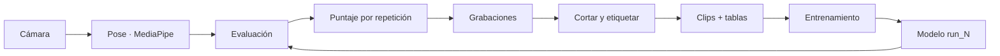
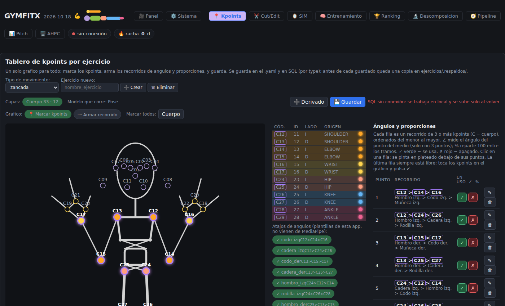
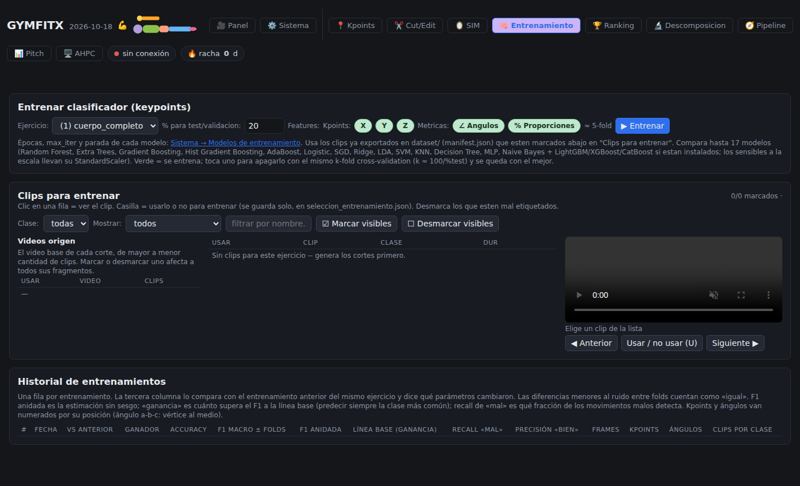

# GYMFITX

**Coach de movimiento por cámara.** Con una webcam, GYMFITX detecta tu cuerpo en vivo (33 puntos de *MediaPipe Pose*), cuenta las repeticiones de un ejercicio y puntúa qué tan bien ejecutaste cada una. Con tus propias grabaciones arma un dataset de clips *bien / mal* y entrena un clasificador que después **puntúa en vivo**.

> Proyecto académico de visión por computadora y ciencia de datos. Todo corre en tu PC: el video no sale de ella.

## Qué hace

- **En vivo:** detección de pose, conteo de repeticiones y puntaje por repetición, con el overlay de puntos sobre la cámara.
- **Ejercicios configurables:** cada ejercicio es un `.yaml` (puntos, ángulos y proporciones, reglas de postura). Incluidos: zancada, cuerpo completo, curl de bíceps, manguito rotador y sentadilla; se crean y editan desde el panel.
- **Dataset propio:** se cortan y etiquetan las grabaciones (*bien / mal / base*), se exportan clips y se preparan las tablas de entrenamiento.
- **Entrenamiento:** varios modelos de scikit-learn con validación **por grabación** (sin fuga entre clips del mismo video), métricas y gráficas por corrida.
- **Preparación reproducible (CRISP-DM, etapa 3):** selección, limpieza, construcción, integración y formato como etapas de DVC, con parámetros en `params.yaml`, diccionario de datos e informe de limpieza.
- **Panel web local** (FastAPI + JavaScript sin frameworks) y, opcionalmente, publicación con un túnel de Cloudflare protegido con usuario y clave.

## Cómo funciona



Cada etapa del pipeline vive en su propia rama de `src/` y solo usa las anteriores (lo verifica `tests/test_capas.py`). El detalle está en [docs/PIPELINE.md](docs/PIPELINE.md).

## Recorrido por el panel

**1. Panel — grabar y puntuar en vivo.** Eliges el ejercicio en la *Rutina*, prendes la cámara y ves el overlay de puntos, el contador de repeticiones y el puntaje de cada una. Abajo queda el puntaje por día y las repeticiones recientes.


**2. Kpoints — definir qué se mide.** Marcas sobre el cuerpo los puntos que usa el ejercicio y armas los recorridos de ángulos y proporciones (por ejemplo hombro > codo > muñeca). Todo se guarda en el `.yaml` del ejercicio.



**3. Pipeline — de la cámara al modelo.** Resume los 11 pasos con su entrada y salida: capturar, elegir puntos, detectar, cortar y clasificar, exportar, normalizar, ángulos, elegir clips, entrenar y ver resultados.


**4. Entrenamiento — clasificador bien / mal.** Eliges qué clips usar y qué variables (kpoints, ángulos, proporciones); se comparan hasta 17 modelos con validación cruzada por grabación y cada corrida queda en el historial.



> Capturas con el panel recién instalado (sin cámara ni datos). Con tus grabaciones se llenan los gráficos y tablas.

## Empezar

Requisitos: **Windows**, **Python 3.11 o 3.12** y una **webcam**. SQL Server es opcional (historial y dataset en base de datos; sin él, el panel arranca igual).

```
UPDATE.bat      # una vez (y cuando cambie requirements.txt): crea .venv e instala
GYMFITX.bat     # a diario: abre el panel en http://127.0.0.1:8000
```

Luego, en el panel: elige un ejercicio → **Grabar** la referencia (5 repeticiones lentas) → graba tus series y mira el puntaje. Para entrenar un clasificador: ✂️ **Cortar videos** → ⬇ **Generar cortes** → 🧠 **Entrenamiento**.

## Estructura

```
src/            el código, una rama por función (nucleo · captura · procesamiento · evaluacion · sesion ·
                etiquetado · preparacion · entrenamiento · interfaz)
ejercicios/     un .yaml por ejercicio
params.yaml     umbrales de la preparación de datos (no viven en el código)
dvc.yaml        las 5 etapas de preparación como pipeline reproducible
docs/           arquitectura, pipeline, decisiones, diccionario de datos y documentación del código
scripts/        utilidades sin panel (grabar, evaluar, búsqueda de features en HPC…)
tests/          pytest (sin cámara ni SQL Server: MediaPipe simulado)
datos/          lo que genera el uso (grabaciones, clips, modelos): no se versiona
```

## Documentación

| Documento | Contenido |
|---|---|
| [docs/PIPELINE.md](docs/PIPELINE.md) | Cada etapa: entrada, salida, módulo responsable |
| [docs/ARQUITECTURA.md](docs/ARQUITECTURA.md) | Diseño y regla del árbol de capas |
| [docs/DESARROLLO.md](docs/DESARROLLO.md) | Estructura detallada, variables de entorno, desarrollo |
| [docs/GUIA_ETAPA3.md](docs/GUIA_ETAPA3.md) | DVC, GitHub y verificación de los criterios CRISP-DM |
| [docs/decisiones/](docs/decisiones/) | Por qué se decidió cada cosa (parámetro → código → salida) |
| [docs/diccionario/](docs/diccionario/) | Qué es cada columna del vector de entrada |
| [docs/codigo/](docs/codigo/) | Referencia del código, generada de los docstrings |
| [CHANGELOG.md](CHANGELOG.md) | Cambios por versión |

## Reproducir la preparación de datos

```
pip install -r requirements-dev.txt
dvc repro            # rehace solo las etapas cuyo código o parámetros cambiaron
```

Los datos pesados (videos y clips) no están en Git: van a un remoto de DVC. La guía paso a paso está en [docs/GUIA_ETAPA3.md](docs/GUIA_ETAPA3.md).

## Desarrollo

```
pip install -r requirements-dev.txt
ruff check .
pytest
```

Para subir cambios a GitHub hay una herramienta aparte, `subir_github/SUBIR_GITHUB.bat` (usuarios, repositorio, rama y log; ver su `LEEME.md`).

## Privacidad

El video y los puntos se procesan y guardan localmente (`datos/`). Publicar en internet viene **apagado** y, activado, exige usuario y clave; desde internet no se puede apagar el panel ni cambiar la configuración.

## Licencia

Por definir.
