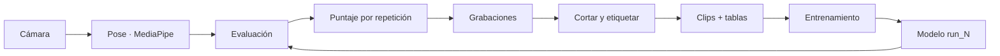
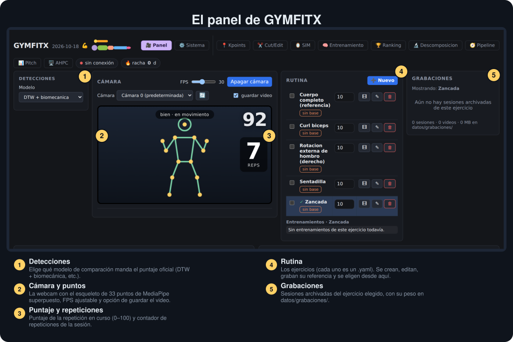
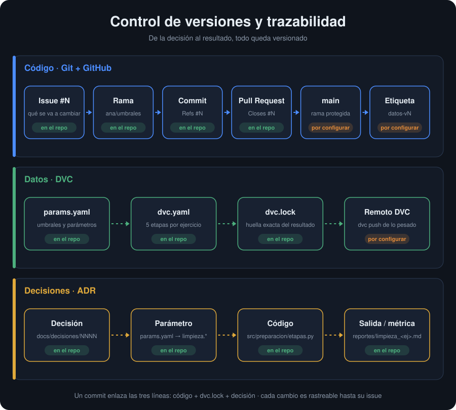

# GYMFITX

**Coach de movimiento por cámara.** Con una webcam, GYMFITX detecta tu cuerpo en vivo (33 puntos de *MediaPipe Pose*), cuenta las repeticiones de un ejercicio y puntúa qué tan bien ejecutaste cada una. Con tus propias grabaciones arma un dataset de clips *bien / mal* y entrena un clasificador que después **puntúa en vivo**.

> Proyecto académico de visión por computadora y ciencia de datos. Todo corre en tu PC: el video no sale de ella.

**Contexto:** Proyecto Integrador I · UTEC Posgrado · metodología CRISP-DM.
**Equipo:** Diego Sánchez Salazar · Estuardo Oliver Campos · Yessenia Chirinos.

## Contenido

[Qué hace](#qué-hace) · [Cómo funciona](#cómo-funciona) · [Recorrido visual](#recorrido-visual) · [Empezar](#empezar) · [Estructura](#estructura) · [Documentación](#documentación) · [Preparación de datos (CRISP-DM etapa 3)](#preparación-de-datos-crisp-dm-etapa-3) · [Desarrollo](#desarrollo) · [Estado del proyecto](#estado-del-proyecto) · [Privacidad](#privacidad)

## Qué hace

- **En vivo:** detección de pose, conteo de repeticiones y puntaje por repetición, con el overlay de puntos sobre la cámara.
- **Ejercicios configurables:** cada ejercicio vive en `parameters/<n>/` (puntos, ángulos y proporciones, reglas de postura). Incluidos: zancada y cuerpo completo; se crean y editan desde el panel.
- **Dataset propio:** se cortan y etiquetan las grabaciones (*bien / mal / base*), se exportan clips y se preparan las tablas de entrenamiento.
- **Entrenamiento:** varios modelos de scikit-learn con validación **por grabación** (sin fuga entre clips del mismo video), métricas y gráficas por corrida.
- **Preparación reproducible (CRISP-DM, etapa 3):** selección, limpieza, construcción, integración y formato como etapas de DVC, con parámetros en `parameters/config.json`, diccionario de datos e informe de limpieza.
- **Panel web local** (FastAPI + JavaScript sin frameworks) y, opcionalmente, publicación con un túnel de Cloudflare protegido con usuario y clave.

## Cómo funciona



Cada etapa del pipeline vive en su propia rama de `src/` y solo usa las anteriores (lo verifica `tests/test_capas.py`). El detalle está en [docs/PIPELINE.md](docs/PIPELINE.md).

## Recorrido visual

> **[Abrir la guía interactiva](https://estuardoo.github.io/GymFitx/interactivo/)** (pasa el mouse sobre cada paso, el panel y la trazabilidad). También se abre en local: `docs/interactivo/index.html`.

### Del video al modelo



### El panel



### Control de versiones y trazabilidad



Cada cambio se puede seguir de punta a punta: **issue → rama → commit → pull request → main**, los datos pesados con **DVC** (`dvc.lock` guarda la huella exacta) y cada decisión con su parámetro, código y salida en `docs/decisiones/`.

| # | Criterio CRISP-DM (etapa 3) | Cómo verificarlo | Dónde está |
|---|---|---|---|
| 1 | Reproducibilidad | `dvc repro --force` y `git diff --exit-code dvc.lock` (lo corre el CI) | `dvc.yaml`, `dvc.lock` |
| 2 | Datos separados del código | `git ls-files input` solo lista punteros `.dvc` | `input/*.dvc` |
| 3 | Decisiones cubiertas | `pytest tests/test_trazabilidad.py` | `docs/decisiones/` |
| 4 | Parametrización | ningún umbral en `src/`; todo en `parameters/config.json` | `parameters/config.json` |
| 5 | Diccionario de datos | la etapa falla si no coincide el nº de columnas | `docs/diccionario/` |
| 6 | Informe de limpieza | `dvc metrics show` | `reportes/<n>/limpieza.md` |
| 7 | Traza de colaboración | PR con `Closes #N`, rama protegida, etiquetas `datos-vN` | GitHub |

Pasos para activarlo (remoto DVC, token, protección de `main`): [docs/GUIA_ETAPA3.md](docs/GUIA_ETAPA3.md).

### Más pantallas

| Kpoints: qué se mide | Entrenamiento: clasificador bien / mal |
|---|---|
|  |  |

*Capturas ilustrativas del panel recién instalado, sin datos propios.*

## Empezar

Requisitos: **Windows**, **Python 3.11 o 3.12** y una **webcam**. SQL Server es opcional (historial y dataset en base de datos; sin él, el panel arranca igual).

```
UPDATE.bat      # una vez (y cuando cambie requirements.txt): crea .venv e instala
GYMFITX.bat     # a diario: abre el panel en http://127.0.0.1:8000
```

Luego, en el panel: elige un ejercicio → **Grabar** la referencia (5 repeticiones lentas) → graba tus series y mira el puntaje. Para entrenar un clasificador: ✂️ **Cortar videos** → ⬇ **Generar cortes** → 🧠 **Entrenamiento**.

## Estructura

```
src/            el código, una rama por función (nucleo · captura · procesamiento · evaluacion · sesion ·
                etiquetado · preparacion · entrenamiento · interfaz)
parameters/     configuración numerada: exercise.json, <n>/ (definición de cada ejercicio), inputs.json (tablas raw y clips), config.json (umbrales), server.json…
input/          datos: raw (grabación) → bronze (clips) → plate (intermedio) → gold (normalizado); no se versiona (DVC)
output/         models/<n>/run_NNN (modelos) y reportes/
sistema/        estado de ejecución: logs, SQL, previews (no se versiona)
assets/         modelos de MediaPipe
dvc.yaml        las 5 etapas de preparación como pipeline reproducible
dvc.lock        huella de cada etapa (se versiona: es la anotación que genera DVC)
.dvc/           configuración compartida de DVC y su remoto (sin credenciales)
docs/           arquitectura, pipeline, decisiones, diccionario de datos y documentación del código
scripts/        utilidades sin panel (grabar, evaluar, reprocesar, generar docs; scripts/hpc/ = búsqueda de features en el cluster)
tests/          pytest (sin cámara ni SQL Server: MediaPipe simulado; usan sus propios ejercicios en tests/data)
```

Detalle del árbol y de las dos tablas (`raw`, `clips`): [docs/ESTRUCTURA_DATOS.md](docs/ESTRUCTURA_DATOS.md).

```
```

## Documentación

| Documento | Contenido |
|---|---|
| [docs/PIPELINE.md](docs/PIPELINE.md) | Cada etapa: entrada, salida, módulo responsable |
| [docs/ARQUITECTURA.md](docs/ARQUITECTURA.md) | Diseño y regla del árbol de capas |
| [docs/DESARROLLO.md](docs/DESARROLLO.md) | Estructura detallada, variables de entorno, desarrollo |
| [docs/GUIA_ETAPA3.md](docs/GUIA_ETAPA3.md) | DVC, GitHub y verificación de los criterios CRISP-DM |
| [docs/decisiones/](docs/decisiones/) | Por qué se decidió cada cosa (parámetro → código → salida) |
| [docs/diccionario/](docs/diccionario/) | Qué es cada columna del vector de entrada |
| [docs/codigo/](docs/codigo/) | Referencia del código, generada de los docstrings |
| [docs/interactivo/](docs/interactivo/index.html) | Guía interactiva: pipeline, panel y trazabilidad |
| [CHANGELOG.md](docs/CHANGELOG.md) | Cambios por versión |

## Preparación de datos (CRISP-DM etapa 3)

La preparación está versionada con **DVC**: cada etapa es reproducible y cada umbral vive en `parameters/config.json`, no en el código.

| Etapa CRISP-DM | Qué hace | Parámetros (`parameters/config.json`) | Decisión |
|---|---|---|---|
| 3.1 Seleccionar | elige clips y excluye la clase `base` | `seleccion` | [0001](docs/decisiones/0001-datos-en-disco-crudo-y-respaldo-sql.md) |
| 3.2 Limpiar | saca clips con pocos cuadros o demasiados puntos sin detección | `limpieza` | [0005](docs/decisiones/0005-umbrales-de-limpieza.md) |
| 3.3 Construir | genera ventanas «fuera» para contar en vivo | `construccion` | [0006](docs/decisiones/0006-clase-fuera-registros-generados.md) |
| 3.4 Integrar | une las tablas de los ejercicios | `ejercicios` | — |
| 3.5 Formatear | normaliza y arma el vector de entrada; partición por grabación | `formato`, `entrenamiento` | [0007](docs/decisiones/0007-formato-del-vector.md), [0002](docs/decisiones/0002-particion-por-grabacion.md) |

La cadena de trazabilidad es **decisión → justificación → código → parámetro → salida → métrica** (índice en [docs/decisiones/](docs/decisiones/README.md)).

```
pip install -r requirements.txt
dvc repro            # rehace solo las etapas cuyo código o parámetros cambiaron
```

Salidas: `docs/diccionario/<ejercicio>.md` (qué es cada columna) y `reportes/<n>/limpieza.md` (qué se sacó y por qué). Los datos pesados (videos y clips) no están en Git: van a un remoto de DVC. Cómo verificar cada criterio y los pasos pendientes: [docs/GUIA_ETAPA3.md](docs/GUIA_ETAPA3.md).

## Desarrollo

```
pip install -r requirements.txt
ruff check .
pytest
```

Un solo archivo de dependencias, `requirements.txt` (versiones exactas): lo usan `UPDATE.bat`, GitHub Actions y el panel.

Los resultados de cada corrida quedan en `output/models/<n>/run_NNN/` (métricas, gráficas y de qué clips salió).

Para subir cambios a GitHub se usa **GITHUB_LOADER2**, un programa aparte que vive fuera de este proyecto (sube por bloques, recuerda lo ya subido, hace `dvc push` antes del `git push`). Las llaves (tokens, clave de Drive) están en la carpeta `KEYS`, también fuera: ni el programa ni las llaves son parte del repositorio.

## Estado del proyecto

| Parte | Estado |
|---|---|
| Panel en vivo, conteo y puntaje | funcionando |
| Corte y etiquetado de clips | funcionando |
| Preparación reproducible con DVC (etapa 3) | implementada |
| Remoto de datos de DVC | **Google Drive** (carpeta `1YXv5yP8nFHSeF4XjDtRTDb6tpM14XDSx`, cuenta de servicio) ([decisión 0010](docs/decisiones/0010-remoto-de-datos-dvc.md)) |
| Clasificador bien / mal | prototipo: pocos clips etiquetados, resultados todavía no concluyentes |

Limitaciones conocidas: el volumen de datos es pequeño y está desbalanceado entre ejercicios y personas; por eso la validación se hace por grabación y las métricas deben leerse con cautela.

## Privacidad

El video y los puntos se procesan y guardan localmente (`input/`). Publicar en internet viene **apagado** y, activado, exige usuario y clave; desde internet no se puede apagar el panel ni cambiar la configuración.

## Licencia

Por definir (pendiente de acordar con el equipo).
